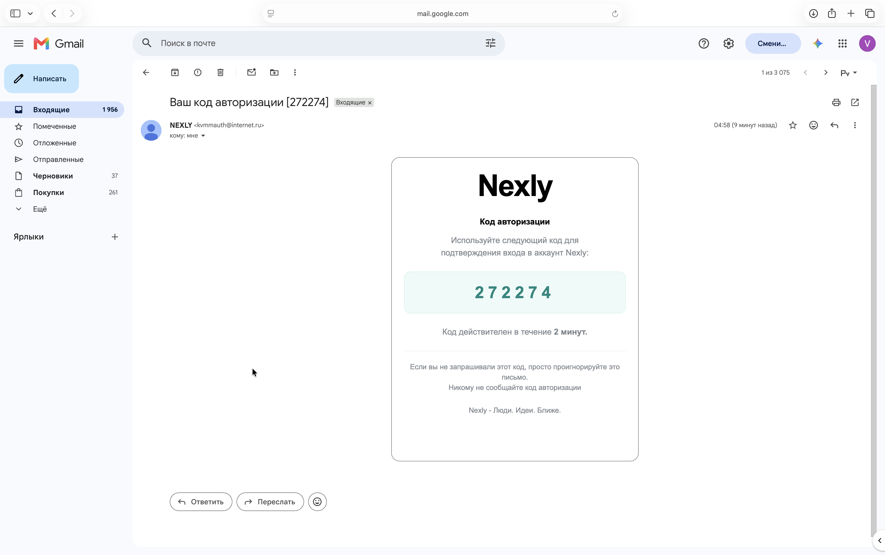

# Работает на smtp.mail.ru

### Запрашиваем код регистрации  
```
vovagusev@MacBook-Air kvmm % curl -X 'POST' \
  'http://localhost/api/auth/register/email/send/code' \
  -H 'accept: application/json' \
  -H 'Content-Type: application/json' \
  -d '{
  "email": "gussev.vova141205@gmail.com",
  "privacy_policy_allowed": true
}'
{"message":"verification code sent"}

```
###   
  
### Ввели не верный код    
```
vovagusev@MacBook-Air kvmm % curl -X 'POST' \
  'http://localhost/api/auth/register/email/code' \
  -H 'accept: application/json' \
  -H 'Content-Type: application/json' \
  -d '{
  "code": "222224", 
  "email": "gussev.vova141205@gmail.com"
}'
{"code":"invalid_code_or_request","message":"invalid or expired email code"}


```
### Ввели верный код  
```
vovagusev@MacBook-Air kvmm % curl -X 'POST' \
  'http://localhost/api/auth/register/email/code' \
  -H 'accept: application/json' \
  -H 'Content-Type: application/json' \
  -d '{
  "code": "272274",
  "email": "gussev.vova141205@gmail.com"
}'
{"profile":{"id":1,"nickname":"gussev.vova141205","email":"gussev.vova141205@gmail.com","created_at":"2026-10-13T01:59:31.572185136Z"},"csrf_token":"45a612e62b290a94d3621c20b1a9f83e14ac5250f0c2236d8564654cf0896a2e"}

```
